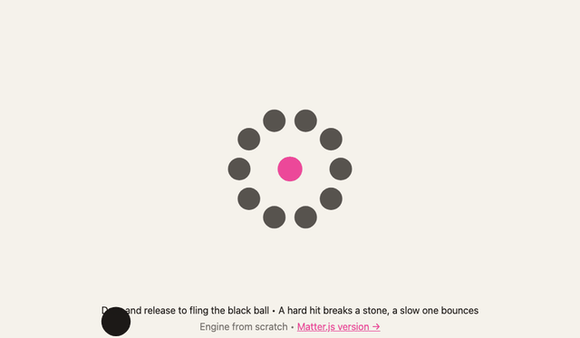

# RESCUE OPERATION — A Physics Engine From Scratch

[](https://m2-md.github.io/canvas-physics-from-scratch/)
[](https://javascript.plainenglish.io/how-game-physics-works-building-a-2d-physics-engine-from-scratch-in-canvas-5cd26416ddb8?source=friends_link&sk=f9c8048fe5b2d513b3c0d26127e97fb4)
[](https://www.buymeacoffee.com/mkare/e/599265)
[](./tsconfig.json)



> A lightweight 2D rigid-body physics engine built from scratch — circles, wall bounce,
> impulse resolution and a slingshot game — compared against Matter.js.

## 2D Canvas & Game Physics Series

| Part | Topic | Live Demo | Free Guide (Friend Link) |
| :--- | :--- | :--- | :--- |
| **Part 1** | **2D Rigid-Body Physics & Slingshot** *(this repo)* | [▶ Play Demo](https://m2-md.github.io/canvas-physics-from-scratch/) | [📖 Read Free](https://javascript.plainenglish.io/how-game-physics-works-building-a-2d-physics-engine-from-scratch-in-canvas-5cd26416ddb8?source=friends_link&sk=f9c8048fe5b2d513b3c0d26127e97fb4) |
| **Part 2** | **HiDPI Canvas & `devicePixelRatio`** | [▶ Live Comparison](https://m2-md.github.io/hidpi-canvas-devicepixelratio/) | [📖 Read Free](https://javascript.plainenglish.io/why-does-canvas-look-blurry-on-retina-displays-devicepixelratio-and-the-tale-of-two-sizes-2be8f6e6f7f8?source=friends_link&sk=3c3af29a65f3d3238efd567f24c20b00) |
| **Part 3** | **Fixed Timestep & Render Interpolation** | [▶ Live Metronome](https://m2-md.github.io/fixed-timestep-render-interpolation/) | [📖 Read Free](https://javascript.plainenglish.io/metronome-physics-fixed-timestep-game-loops-and-render-interpolation-in-typescript-cdf54ec5ea11?source=friends_link&sk=ff5390a11e2d97b29e82dc41a6572272) |

> 📦 **Want the bundled TypeScript Starter Kit + cheatsheets?** Grab the [TS 2D Canvas Physics & HiDPI Starter Kit](https://www.buymeacoffee.com/mkare/e/599265) (or unlock it free with a [Buy Me a Coffee membership](https://www.buymeacoffee.com/mkare)).

The working code for the article "How Does Game Physics Work? Writing a Physics
Engine From Scratch on Canvas". It contains three things:

1. **Mini 2D physics engine** (`src/engine/`) — dependency-free, ~120 lines:
   Euler integration, circle-circle collision (impulse), wall bounce, contact events.
2. **Slingshot game** (`src/main.ts`) — fling the black ball with drag-and-release, break
   the ring of stones, rescue the pink ball in the middle. A hard hit breaks a stone, a slow one bounces.
3. **Matter.js comparison** (`src/matter-demo.ts`) — the same scene with an off-the-shelf engine.

## Setup

```bash
npm install
```

## Running

```bash
npm run dev
```

- `http://localhost:5173/` → the game with the from-scratch engine
- `http://localhost:5173/matter.html` → the Matter.js version

**How to play:** Click the black ball, pull, release. It flies in the direction
opposite to the pull (slingshot logic). Stones only break on a fast hit
(threshold: 400 px/s); on a slow hit the ball bounces. Touch the pink ball and you win.

## Test

```bash
npm test
```

14 unit tests verify the engine's physics claims: Euler integration, static
bodies staying put, wall bounce (the bounciness ratio), impulse resolution,
overlap correction, the "don't interfere with separating bodies" rule and the
severity report of contact events.

## File layout

```
src/
  engine/
    vec.ts      # Vec2 helpers (add, sub, scale, dot, normalize)
    body.ts     # Body + createBody (the invMass trick)
    world.ts    # World.step: integration → walls → collisions
  main.ts       # Game: slingshot, ring of stones, rules (in the contact events)
  matter-demo.ts# The same scene with Matter.js
tests/
  engine.test.ts
```

## Lessons learned (also covered in the article)

- While dragging, `pointermove`/`pointerup` are listened for **on window**; listen
  on the canvas and a slingshot released outside the canvas stays stuck.
- In Matter.js a thin wall + high speed = **tunneling** (the ball passes through
  the wall). The fix: a thick wall + a cap on the launch speed.

## Tech stack

- TypeScript
- Vite
- Vitest
- HTML5 Canvas 2D
- Matter.js (comparison demo only)

## License

MIT
